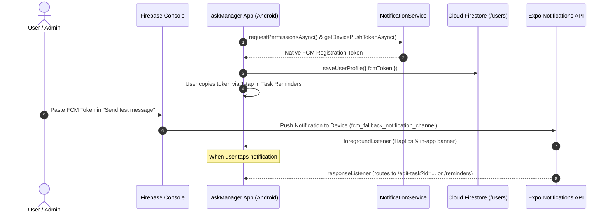

# TaskManager: Enterprise Architecture & Codebase Blueprint

> **Notice**: This document is the single authoritative source of architectural truth for the TaskManager project. Refer to this document before making structural changes.

---

## 1. System Overview & Technology Stack

- **Framework**: React Native (0.88.1) + Expo SDK 58 (Expo Router v4)
- **Design System**: Minimalist Emerald Green (`#10B981`) inspired by Google Tasks & Calendar
- **State Management**: React Context (`TaskContext`, `AuthContext`) with optimistic local updates
- **Backend & Cloud**: Firebase (Authentication, Cloud Firestore) — 100% Free Spark Tier ($0/month) with zero-cost local device caching for attachments & avatars
- **Local Persistence**: Offline-first via `@react-native-async-storage/async-storage`
- **Validation**: Zod schema definitions (`src/types/schemas.ts`)
- **Code Quality**: Strict TypeScript + ESLint (Expo flat config)

---

## 2. Exhaustive Directory & File Tree

```
c:\React Native\TaskManager\
├── app.json                                 # Expo project configuration and native metadata
├── ARCHITECTURE.md                          # Single source of truth architectural blueprint
├── assets/                                  # Static image assets, app icons, and splash screens
├── eslint.config.js                         # ESLint configuration (Expo flat config)
├── firebase.json                            # Firebase CLI & deployment settings
├── firestore.rules                          # Cloud Firestore security rules
├── firestore.indexes.json                   # Cloud Firestore composite indexes
├── google-services.json                     # Firebase Android configuration & credentials
├── package.json                             # Dependencies, scripts, and Expo SDK definitions
├── storage.rules                            # Firebase Storage security rules
├── tsconfig.json                            # TypeScript configuration with path aliases
└── src/
    ├── app/                                 # Expo Router screens & layouts
    │   ├── _layout.tsx                      # Root navigator, fonts, AuthProvider & TaskProvider wrapping
    │   ├── index.tsx                        # Root route auto-redirect to /tabs
    │   ├── auth.tsx                         # Authentication screen (Login / Sign Up / Multi-Account Switcher)
    │   ├── calendar.tsx                     # Calendar Agenda & timeline view
    │   ├── docs.tsx                         # In-app documentation & user guide
    │   ├── edit-task.tsx                    # Detailed task editing & subtask manager
    │   ├── privacy.tsx                      # Privacy Policy screen
    │   ├── profile.tsx                      # User profile, account manager & statistics
    │   ├── reminders.tsx                    # Push notification & reminder management
    │   ├── terms.tsx                        # Terms of Service screen
    │   └── tabs/                            # Primary tab navigation (Bottom bar hidden)
    │       ├── _layout.tsx                  # Tab bar layout (tabBarStyle: none, clean Google Tasks style)
    │       ├── index.tsx                    # Minimalist Tasks dashboard with category chips, task cards & emerald FAB (+)
    │       └── new-task.tsx                 # Full-screen new task creation screen
    ├── components/                          # Reusable UI widgets
    │   ├── animated-icon.tsx                # Cross-platform animated iconography
    │   ├── app-tabs.tsx                     # Custom bottom tab bar component
    │   ├── DateTimePickerModal.tsx          # Google Calendar style interactive date/time modal
    │   ├── GoogleClockTimePicker.tsx        # Google Tasks Material circular clock dial time picker modal
    │   ├── external-link.tsx                # Safe in-app browser linking
    │   ├── hint-row.tsx                     # Inline tip widget for forms
    │   ├── StatsCards.tsx                   # Productivity summary metrics cards
    │   ├── TaskCard.tsx                     # Interactive task list item with swipe/toggle actions
    │   ├── themed-text.tsx                  # Typography component respecting light/dark theme
    │   ├── themed-view.tsx                  # Background container respecting theme
    │   ├── web-badge.tsx                    # Web fallback tag
    │   └── ui/
    │       └── collapsible.tsx              # Expandable/collapsible section
    ├── constants/                           # Design tokens & fixed configurations
    │   ├── designTheme.ts                   # Emerald green palette, typography & spacing tokens
    │   ├── taskConstants.ts                 # Default categories, priorities & filter options
    │   └── theme.ts                         # System light/dark theme color maps
    ├── context/                             # React Context state containers
    │   ├── AuthContext.tsx                  # User authentication, multi-account persistence & session
    │   └── TaskContext.tsx                  # Tasks state, CRUD, filtering, searching & sync queue
    ├── hooks/                               # Custom reusable hooks
    │   ├── use-color-scheme.ts              # Theme detection hook
    │   ├── use-theme.ts                     # Active theme color tokens hook
    │   └── useSafeHaptics.ts                # Cross-platform safe tactile feedback
    ├── repositories/                        # Abstracted data access layer
    │   ├── taskRepository.ts                # Task data coordination between Firestore and local cache
    │   └── userRepository.ts                # User profile & account switching coordination
    ├── services/                            # External integrations & native APIs
    │   ├── accountManager.ts                # Multi-account local storage & active session switching
    │   ├── authService.ts                   # Firebase Auth SDK wrappers (Email/Password, Sign Out)
    │   ├── firebase.ts                      # Firebase App & SDK initialization
    │   ├── firestoreService.ts              # Cloud Firestore CRUD, user profiles & FCM token sync
    │   ├── notificationService.ts           # Expo Notifications & FCM push tokens, channels & deep-link routing
    │   ├── storageService.ts                # Firebase Cloud Storage file uploads & downloads
    │   └── taskStorage.ts                   # AsyncStorage offline task persistence & caching
    ├── types/                               # TypeScript declarations & Zod schemas
    │   ├── schemas.ts                       # Zod validation schemas for Tasks and Subtasks
    │   ├── task.ts                          # Core task interfaces (Task, Subtask, Attachment, etc.)
    │   └── user.ts                          # User profile & saved accounts interfaces
    └── utils/                               # Helper utilities
        ├── fileViewer.ts                    # File attachment preview & sharing utilities
        └── platformAlert.ts                 # Cross-platform alert & confirm dialog (Android Alert / Web window.confirm)
```

---

## 3. Architectural Layers

| Layer | Directories / Files | Responsibility |
| :--- | :--- | :--- |
| **Presentation Layer** | `src/app/`, `src/components/` | Screen navigation (Expo Router), UI components, modals, touch interactions, visual emerald theme. |
| **State Management Layer** | `src/context/` (`AuthContext`, `TaskContext`) | Optimistic UI state, active account, task filtering, local caching triggers. |
| **Business Logic Layer** | `src/types/schemas.ts`, `src/hooks/` | Zod input validation, business rules, haptics, color schemes. |
| **Repository Layer** | `src/repositories/` | Decoupled data contracts uniting remote cloud and local storage. |
| **Service Layer** | `src/services/` | Firebase SDKs (Auth, Firestore `/tasks` and `/users`, Storage), Expo Notifications, AsyncStorage. |
| **Cloud Infrastructure** | `firestore.rules`, `firestore.indexes.json` | User-scoped security rules, composite indexing on `(userId, completed, createdAt)`. |

---

## 4. End-to-End Data Flow & State Lifecycle

```mermaid
flowchart TD
    subgraph UI ["Presentation Layer (Expo Router)"]
        A["User Action (Create/Edit Task)"]
        T["Tasks Screen (tabs/index.tsx)"]
        M["Add Task Screen / Modal"]
    end

    subgraph State ["State Management (Context)"]
        TC["TaskContext"]
        AC["AuthContext"]
    end

    subgraph Logic ["Business Logic & Validation"]
        Z["Zod Validation (schemas.ts)"]
    end

    subgraph Repos ["Repository Layer"]
        TR["taskRepository"]
        UR["userRepository"]
    end

    subgraph Storage ["Data Sources"]
        FB["Remote: Firebase Firestore / Data Connect"]
        AS["Local: AsyncStorage (Offline-First Cache)"]
    end

    A --> M
    M -->|Validated input| Z
    Z --> TC
    TC -->|1. Optimistic Update (0ms UI latency)| T
    TC --> TR
    TR -->|Save to local cache| AS
    TR -->|Sync to cloud when online| FB
    AC --> UR
    UR --> FB
    UR --> AS
```

---

## 5. Feature-to-File Fast Lookup Matrix

| Feature / Capability | Primary Screen(s) | Context / Store | Repository / Service | Models & Schemas |
| :--- | :--- | :--- | :--- | :--- |
| **Minimalist Tasks Dashboard** | `src/app/tabs/index.tsx` | `TaskContext.tsx` | `taskRepository.ts`, `taskStorage.ts` (user-scoped `@task_manager_tasks_${uid}`) | `src/types/task.ts` |
| **Starred & My Tasks Filters** | `src/app/tabs/index.tsx` | `TaskContext.tsx` | `toggleStarred`, `taskLists` | `src/types/task.ts` |
| **List 3-Dot Options (Rename / Delete)** | `src/app/tabs/index.tsx` | `TaskContext.tsx` | `taskRepository.ts` | `src/types/task.ts` |
| **Floating Action Button (FAB +)** | `src/app/tabs/index.tsx` | `TaskContext.tsx` | `router.push('/tabs/new-task')` | `src/types/task.ts` |
| **Create Task Screen & Dual Save Buttons** | `src/app/tabs/new-task.tsx` | `TaskContext.tsx` (`taskLists`) | `taskRepository.ts`, `firestoreService.ts` (`setDoc` merge) | `src/types/schemas.ts` |
| **Edit Task & Subtasks (Dual Save Buttons)** | `src/app/edit-task.tsx` | `TaskContext.tsx` (`taskLists`) | `taskRepository.ts`, `firestoreService.ts` | `src/types/schemas.ts` |
| **Calendar Agenda & Timeline** | `src/app/calendar.tsx` | `TaskContext.tsx` | `taskRepository.ts` | `src/types/task.ts` |
| **Authentication Form** | `src/app/auth.tsx` | `AuthContext.tsx` | `authService.ts` | `src/types/user.ts` |
| **Manage Accounts, Add Account & 1-Tap Switcher** | `src/app/profile.tsx`, `src/app/auth.tsx` | `AuthContext.tsx` (`@task_manager_active_account_uid`) | `accountManager.ts`, `userRepository.ts`, `authService.ts` | `src/types/user.ts` |
| **Per-User Avatar Isolation (DP per ID)** | `src/app/profile.tsx`, `src/app/tabs/index.tsx` | `AuthContext.tsx` (`@user_avatar_${uid}`) | `userRepository.ts`, `storageService.ts`, Firestore `/users` | `src/types/user.ts` |
| **Date & Time Picker Modal** | `src/components/DateTimePickerModal.tsx` | Local State | Native Date / Haptics | `src/types/task.ts` |
| **Material Clock Dial Picker** | `src/components/GoogleClockTimePicker.tsx` | Local State | Circular Dial Math / Haptics | `src/types/task.ts` |
| **File Attachments** | `src/app/edit-task.tsx` | `TaskContext.tsx` | `storageService.ts` | `src/types/task.ts` |
| **Task Reminders & Local Notifications** | `src/app/reminders.tsx` | `TaskContext.tsx` | `notificationService.ts` | `src/types/task.ts` |
| **Firebase Cloud Messaging (FCM Background Sync & Push)** | `src/app/_layout.tsx` | `AuthContext.tsx` | `notificationService.ts`, `firestoreService.ts` | `src/types/user.ts` |

---

## 6. Firebase Cloud Messaging (FCM) Push Architecture


